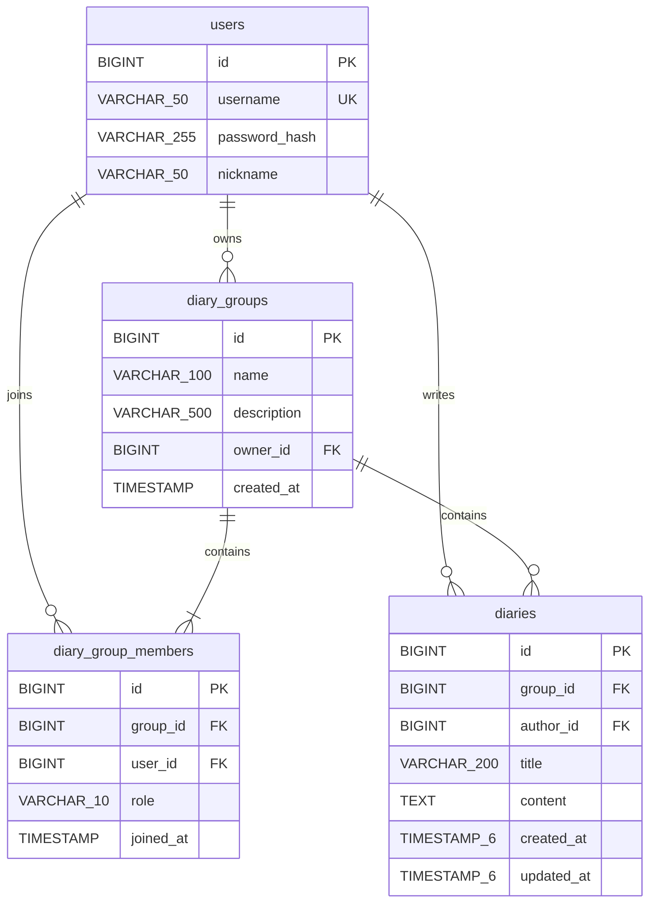

# 데이터베이스 구조

MySQL, InnoDB, utf8mb4를 사용한다. 실제 SQL은 `backend/src/main/resources/`에 있다.

## 제약과 권한

- 모든 PK는 AUTO_INCREMENT다.
- `users.username`은 UNIQUE이며 닉네임은 중복 가능하다. 비밀번호 원문을 저장하지 않는다.
- `diary_groups.description`만 NULL을 허용한다. 생성 직후 방장을 OWNER 멤버로 추가하는 작업은 하나의 트랜잭션이다.
- 멤버의 `(group_id, user_id)`는 UNIQUE다. `role`은 CHECK 제약으로 OWNER/MEMBER만 허용한다.
- 일기의 작성자 FK는 `users`를 참조한다. 멤버 행에 연결하지 않으므로 방을 나가도 글이 보존된다.
- 일기 본문은 애플리케이션에서 10,000자로 제한한다. 정렬용 인덱스는 `(group_id, created_at, id)`다.
- 일기 `updated_at`은 수정 시 갱신한다. DB 연결의 `serverTimezone=Asia/Seoul` 설정을 팀에서 맞춘다.

## 삭제 관계

| 관계 | FK 삭제 정책 | 애플리케이션 동작 |
| --- | --- | --- |
| 일기장 → 방장 사용자 | RESTRICT | 회원 탈퇴 기능은 없음 |
| 멤버 → 일기장 | CASCADE | 일기장 삭제 시 소속 멤버 행 삭제 |
| 멤버 → 사용자 | CASCADE | 회원 탈퇴 API는 제공하지 않음 |
| 일기 → 일기장 | RESTRICT | 방장 삭제 서비스가 일기 → 일기장 순서로 삭제 |
| 일기 → 작성자 사용자 | RESTRICT | 작성자 계정을 삭제해 글을 고아 데이터로 만들지 않음 |

방 나가기는 본인의 MEMBER 행 하나만 지운다. 방장은 나가기 대신 일기장 전체 삭제를 선택할 수 있다.
일기장 삭제 서비스는 대상 일기장을 잠그고 권한 검사 후 일기와 일기장을 한 트랜잭션에서 삭제한다.
중간 실패 시 전체 롤백한다. 다른 일기장과 사용자 계정은 변경하지 않는다.

## 초기 적용 순서

1. `lifeisoneday` DB 생성·선택
2. `signup-schema.sql`
3. `group-schema.sql`
4. `diary-schema.sql`

SQL은 자동 실행되지 않는다. 기존 테이블이 있을 때 `CREATE TABLE IF NOT EXISTS`는 구조를 고치지 않으므로
기존 컬럼·FK가 위 SQL과 일치하는지 확인한다. 이번 통합 단계는 기존 세 SQL을 그대로 사용하며 추가 마이그레이션이 없다.
